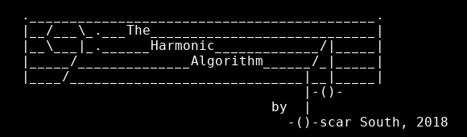

# The Harmonic Algorithm

> *"My music of today is so much based on the new musical technology. We use the technology as a material for our musical art"*
> — Igor Stravinsky, 1957



[](https://github.com/OscarSouth/theHarmonicAlgorithm/actions/workflows/ci.yml)
[](https://docs.theharmonicalgorithm.com/)
[](LICENSE)
[](https://buymeacoffee.com/oscarsouth)

___
### Welcome to The Harmonic Algorithm :)
###### This codebase is an expression of my musical mind -- it provides structure for navigating through and interacting with musical harmonic state in real time, while experiencing it. Traversing the harmonic space feels kind of like an 'LLM', but there's no AI here, just old school counting and music theory, implemented in Haskell. 
___

The Harmonic Algorithm system, intergrated with TidalCycles, generates
musical harmony states inside user defined musical constraints, then
ranks it using a tailored 'cube' of Markov Chain matrices trained on the
Yale Classical Archives Corpus. This presents a unique tool in the hands 
of the composer or performer which can be used as a composing aid, 
analysis device, for instrumental study or even in live performance.

This open-source project is based on a long term creative agenda that I've
pursued for many years, originating from an interest as an electric bass player
utilising the overtones of the instrument in performance and composition.

The Harmonic Algorithm takes the underpinning theoretical ideas from this
research and realises them as a Haskell library with deep TidalCycles
integration for live coding. Under the hood, harmonic transitions from over
10,000 compositions by over 1,000 classical and jazz composers are stored in a
Neo4j graph database. The system memorises how
harmony moves, and uses this knowledge to generate progressions that feel
musically coherent while remaining endlessly surprising. 
No AI -- just counting and music theory.

The core idea draws on Geraint Wiggins' Creative Systems Framework: define
the *rules* of what's harmonically possible, *evaluate* the quality of each
option using corpus statistics and dissonance scoring, then *traverse* the
space probabilistically, balancing between the familiar and the unexpected.

The project is built around four 'named entities':

- **The Harmonic Algorithm** -- A *Rules→Evaluation→Traversal* pipeline
  that produces harmonic progressions from learned transition probabilities,
  originating in a 2016 exhaustive overtone analysis of bass guitar, realised
  computationally in Haskell with Neo4j as a graph traversal backend.

- **Algorithmic Orchestration** -- Did you ever want to write for the
  orchestra using Haskell code? What if that system could only produce viable
  arrangements that could be notated and would be playable by a real orchestra?
  How about if *The Harmonic Algorithm* was the harmony engine powering it?
  What if I could 'play' the orchestra in real time in using TidalCycles?
  These are all questions I asked myself, so I built a system that can do it.
  It give the concept of *composing functions* a whole new meaning.

- **The Spectral Narrative** -- A structural framework for musical form. 
  Macro-level compositional arcs encoded as programmable 'kinetics' signals
  in seconds or bars, with smooth or snap transitions, carrying continuous
  intensity and dynamics envelopes that drive instrument activation, voice
  density, and harmonic layer switching. It's how I turn code into composition.

- **Octatripentatonics** -- Where things get weird. A whole new system 
  of harmonic organisation based on 8 note tonal areas (octa), divided into
  three overlapping pentatonic scales (tripentatonics) which any combination
  of two of will produce a different 7 tone key signature. You can ignore it
  or embrace it, but if you think that wacky music theory ideas are cool,
  then check out the system and tonal structure elements:
  ([OCTATRIPENTATONICS.md](documents/OCTATRIPENTATONICS.md),
  [CHORDSCALE.md](documents/CHORDSCALE.md)).

The system has grown with me over the years and I've mainly used it privately
in the studio to have fun playing with synthesizers, orchestral modules, and
as a very soliloquistic jamming-buddy that never drops from the session
at the last minute. I've performed a few concerts here and there too.

I figure that it'd be nice to make the whole system available publicly as 
an open source project, whether for people to use creatively or to just
enjoy the music and art that it can create, through art published on YouTube:
[The Harmonic Algorithm Youtube Channel](https://www.youtube.com/@theharmonicalgorithm)

> ### ▶ VIDEO: Overview/Demonstration:
> This is a longer form musical tour of The Harmonic Algorithm concepts,
> it is clipped from a longer stream and patterns synthesizers musically.
> There are some shorter quickstart/demonstrative style videos below.
>
> <a href="https://youtu.be/2w_mH8NWdsA"></a>
___

## Research

The original 2016 research documents on which The Harmonic Algorithm draws
influence can be accessed at the following links:

Core document:
[original core document (2016)](documents/The_Harmonic_Algorithm_2016.pdf)

Reflective document:
[original reflective document (2016)](documents/Harmonic_Algorithm_Reflections_2016.pdf)

The accompanying document for this project which discusses The Harmonic Algorithm
as a creative system can be accessed here:
[creative system document (2018)](documents/Data_Science_In_The_Creative_Process_2018.pdf)

___

## Quick Start

> ### ▶ VIDEO: Quick Start
> Start simple: a starting chord, a length and an entropy value are all it
> takes to generate a progression, it is combined with a TidalCycles pattern
> that you can voice and play. Constraints then narrow the harmonic space to fit
> your musical context, here with a key and a falling root motion. You can also
> declare a progression by hand, like the Neapolitan cadence this example
> ends on:
>
> <a href="https://youtu.be/rm50o6OcGe4"></a>
>
> Code: [`live/examples/00-QUICK_START.tidal`](live/examples/00-QUICK_START.tidal)

___

## Musical Control

> ### ▶VIDEO: Entropy Levels
> The same starting chord can lead to radically different musical outcomes.
> Entropy controls the balance between familiar harmonic motion and
> surprising, exploratory leaps or less common harmonic textures:
> 
> <a href="https://youtu.be/5L2lJQ1dM_M"></a>
>
> Code: [`live/examples/01-ENTROPY_LEVELS.tidal`](live/examples/01-ENTROPY_LEVELS.tidal)

The system also lets you blend the harmonic taste of different composers.
These are the weighted combinations of learned transition probabilities:

> ### ▶ VIDEO: Composer Blending
> The system also lets you blend the harmonic taste of different composers.
> These are the weighted combinations of learned transition probabilities.
> If you want to run the system without the graph: `seek "none"` bypasses it 
> entirely, so progressions are shaped by your context filters and entropy alone.
>
> <a href="https://youtu.be/ci5GKpaIiZk"></a>
>
> Code: [`live/examples/02-COMPOSER_BLENDING.tidal`](live/examples/02-COMPOSER_BLENDING.tidal)

> ### ▶ VIDEO: Form and Kinetics
> A named component, 'The Spectral Narrative' provides a macro level syntax to
> control 'kinetics' (a proxy for density or layering in arrangement), dynamics
> and modulation. This makes it very easy and flexible to create full compositions.
>
> <a href="https://youtu.be/pAGnlrfvTIQ"></a>
>
> Code: [`live/examples/03-FORM_AND_KINETICS.tidal`](live/examples/03-FORM_AND_KINETICS.tidal)
___

## Installation

The project can be run just with the codebase and tooling, then setting up
the graph in Docker allows full traversal of the composer corpus.

### Dependencies

1. [Haskell Stack](https://docs.haskellstack.org/en/latest/install_and_upgrade/)
   with **GHC 9.10.3** installed and set as default (e.g. via
   [ghcup](https://www.haskell.org/ghcup/)) — `stack.yaml` sets
   `system-ghc: true`, so Stack uses your system GHC rather than
   downloading its own
2. [TidalCycles](https://tidalcycles.org/) with SuperCollider + SuperDirt —
   any editor will do; [`LIVE_ENVIRONMENT.md`](documents/LIVE_ENVIRONMENT.md)
   documents the Pulsar rig this project is performed on, as one worked example
3. [Docker](https://www.docker.com/) — only for the composer graph (second path)

### Automated setup (Linux)

`scripts/install-linux.sh` wires all of this up and is safe to re-run. It
converges to the same state and reports what was already correct:

```bash
./scripts/install-linux.sh --check        # report only, change nothing
./scripts/install-linux.sh                # set everything up
./scripts/install-linux.sh --with-graph   # and load the composer corpus
```

It installs no system packages, it checks for them and names the command to
install any that are missing. The one exception is GHC, which it fetches
through ghcup. Afterwards `livecode` is on your `PATH`.

It exists because several setup steps fail *silently*: without the root
`CLAUDE.md` stub the repo's own agent guidance never loads; without
`SafeMIDIOut.sc` the SuperCollider startup aborts before stamping `sc_ready`
and the launcher waits forever with no error; a copied rather than symlinked
`snippets.cson` drifts and prefixes stop expanding; and `ppm install` silently
wipes the local plugin patch on every upgrade. The script handles each, and
`--check` tells you which are outstanding.

There is no macOS equivalent yet; the repository files it configures are
cross-platform, only the wiring is Linux-specific.

### 1. Start here, no database required

```bash
git clone https://github.com/OscarSouth/theHarmonicAlgorithm
cd theHarmonicAlgorithm

stack build      # compile the library
stack test       # verify everything works
```

Boot TidalCycles with `live/BootTidal.hs` and you're playing. Generation
runs on the built-in consonance fallback — pass `"none"` as the composer
string and everything in the guides works, shaped by your own filters and
entropy:

```haskell
start <- lead "C maj"
s <- seek "none" $ cue start $ len 4 $ entropy 0.5 $ gen
```

You can also explore in the REPL with `stack ghci`.

### 2. Add the composer graph

The graph holds harmonic transitions learned from 8,441 classical pieces by
488 composers (the Yale Classical Archives Corpus) and 2,614 jazz tunes (the
Jazz-Chord-Progressions-Corpus), with a breakdown in the
[Composer Catalogue](documents/COMPOSERS.md). Start Neo4j, then load the pre-built database published with the
[latest release](https://github.com/OscarSouth/theHarmonicAlgorithm/releases):

```bash
# download the graph (98MB) and its checksum
curl -LO https://github.com/OscarSouth/theHarmonicAlgorithm/releases/download/corpus-v3/ycacl-graph.dump
curl -L https://github.com/OscarSouth/theHarmonicAlgorithm/releases/download/corpus-v3/SHA256SUMS | shasum -a 256 -c

# load it (the database must be offline), then start Neo4j
docker compose stop neo4j
docker run --rm -i -v "$PWD/neo4j/data:/data" neo4j:5.26 \
  neo4j-admin database load neo4j --from-stdin --overwrite-destination < ycacl-graph.dump
docker compose up -d neo4j
```

Every `seek` string then works: `"bach"`, `"debussy"`,
`"bach:30 debussy:70"`, `"*"`.

<details>
<summary>Rebuilding the graph from source (advanced)</summary>

`stack run` populates Neo4j from `data/artefacts/ycacl_sequences.csv`, which is not
distributed with the repository. To produce it, obtain the Yale Classical
Archives Corpus yourself (see [NOTICES.md](NOTICES.md) for provenance) and run
the export helper documented in `scripts/README.md`:

```bash
Rscript scripts/export_ycacl.R <YCACL dir> <metadata csv> data/artefacts/ycacl_sequences.csv
stack run
```
</details>

___

## Going Deeper

Once you're up and running, there's plenty to explore:

**[User Guide](USER_GUIDE.md)** — the full walkthrough in readable form,
video slots and all, no running TidalCycles environment required.

**[Interactive User Guide](live/USER_GUIDE.tidal)** — the same guide as a
hands-on tutorial with examples you can run directly in TidalCycles.

**[Octatripentatonics](documents/OCTATRIPENTATONICS.md)** — the theory frontier:
strata, tristrata, and the three-layer harmony system, in full.

**[Polytonal](documents/POLYTONAL.md)** — the genE framework: a foundation
walk plus two partner triad chains, the overlap algebra behind the layer
selectors, and the viability study the design rests on.

**[Chordscale](documents/CHORDSCALE.md)** — key-area analysis for gen and
genJ: the composite-minor key lattice, the mode and pentatonic layer
derivation, and the walking-bass unification.

**[Algorithmic Orchestration](documents/ALGORITHMIC_ORCHESTRATION.md)** — scoring for
a virtual orchestra on the JV-1010: instrument catalogue, voice lines, divisi,
sections, blends, form and kinetics.

**[The Live Environment](documents/LIVE_ENVIRONMENT.md)** — the editor, boot
and SuperCollider rig the project is performed on, and the instruments behind it:
Pulsar configuration, the compiled-session wrapper, MIDI routing, the studio rig's
channel map and MPC programs, the AIRA units, and the failure modes worth recognising.

**[API Reference](https://docs.theharmonicalgorithm.com/)** — generated Haddock
documentation for all 50 modules, with worked examples on every user-facing
entry point. Start at `Harmonic.Lib`.

**[Architecture Guide](documents/ARCHITECTURE.md)** — the technical deep dive into
how the system works: the four-layer architecture, the R→E→T pipeline,
zero-form cadence storage, and the graph database model.

**[Data Modelling](documents/DATA_MODELLING.md)** — how corpus harmony becomes
the cadence graph: zero-form abstraction, weighted interpretation, and
consistent-path transition counting.

**[Composer Catalogue](documents/COMPOSERS.md)** — every composer key in the
graph and the query syntax for names and blends.

**[Changelog](CHANGELOG.md)** — V3 features and migration notes.

**[The original demo (V1, 2018–19)](documents/LEGACY_V1_DEMO.md)** — a piece of
history: the interactive terminal app this grew out of, walkthrough and
animations preserved.

___

## Acknowledgments

This project wouldn't exist without the work of:

- **Geraint A. Wiggins** — the Creative Systems Framework that underpins
  the algorithm's architecture
- **Alex McLean** — TidalCycles, which gave this project its voice
- **Paul Hindemith** — interval dissonance theory from The Craft of Musical
  Composition (1937), which informs the evaluation scoring
- **UCI Machine Learning Repository** — the Yale Classical Archives Corpus
  that trains the classical model
- **Carey Bunks** — the Jazz-Chord-Progressions-Corpus (ISMIR 2023) that
  trains the jazz model; full citation in [NOTICES.md](NOTICES.md)

___

Let me know if you have any feature suggestions or comments in general and
feel free to get in touch through this repository's
[Issues](https://github.com/OscarSouth/theHarmonicAlgorithm/issues) section.

Alternatively, come hang out or contact me through the forum 
for my main performance project UDAGAN:
https://forum.UDAGAN.uk/

If the project is useful to you and you'd like to help keep the research going,
you can [buy me a coffee](https://buymeacoffee.com/oscarsouth) — or use the
**Sponsor** button at the top of this page. A star is free and helps just as much.

Oscar

___

GNU General Public License v3.0 — see [LICENSE](LICENSE) for details.
